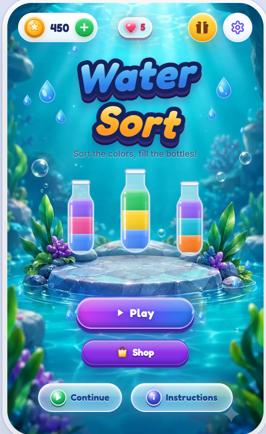
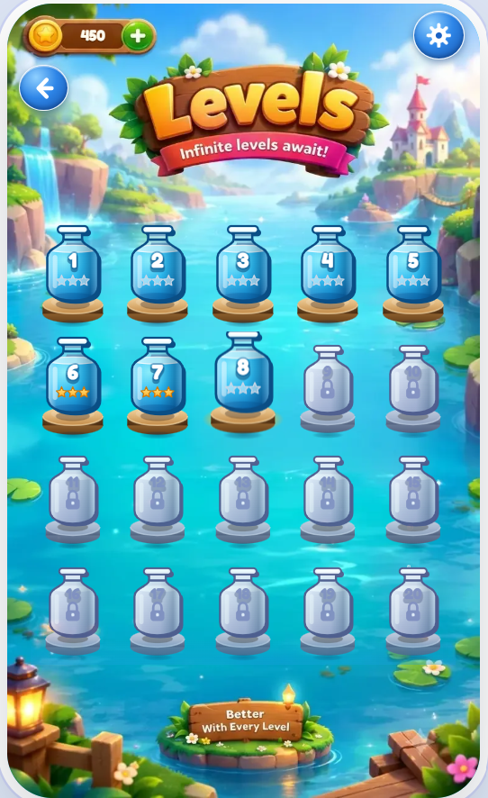
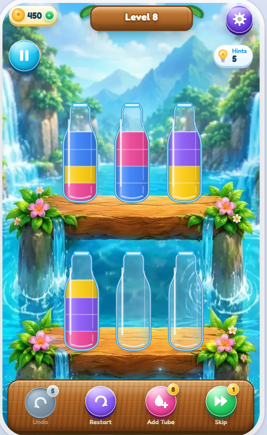
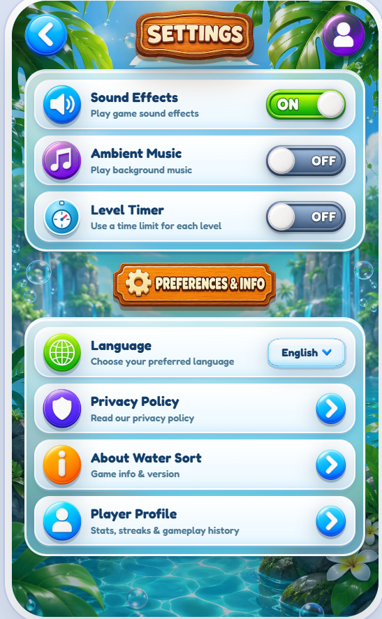
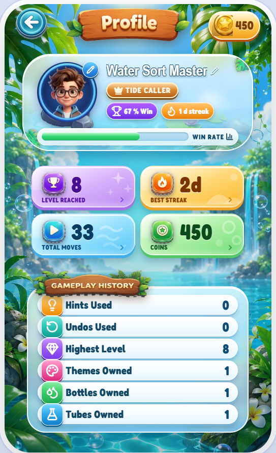
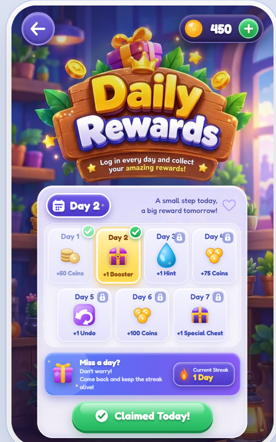

# 💧 Water Sort Puzzle — React.js

A modern and interactive **Water Sort Puzzle Game** built with **React.js and Vite**. The game features dynamic puzzle generation, animated liquid pouring, multiple difficulty levels, player progression, themes, daily challenges, rewards, achievements, and persistent game data.

🔗 **Live Demo:** https://water-sort-puzzle-1.vercel.app

🔗 **GitHub:** https://github.com/nagarjuna1245/Water-sort-ReactJs-

---

## 🎮 Features

### 🧪 Core Gameplay

* Classic Water Sort Puzzle mechanics
* Pour liquid between tubes/bottles
* Automatic move validation
* Matching-color liquid transfer
* Dynamic liquid levels
* Puzzle completion detection
* Move counter
* Best moves tracking
* Undo functionality
* Restart level
* Add Tube functionality
* Hint system
* Animated pouring with bottle/tube tilt
* Gravity-based liquid transfer animation
* Win/completion screen

### 🎯 Game Modes

* Normal difficulty
* Hard difficulty
* Dynamic level generation
* Multiple puzzle configurations
* Increasing puzzle complexity

### 🏆 Progression System

* Level unlocking
* Completed-level tracking
* Star ratings
* Best-move records
* Coins/rewards
* Player statistics
* Achievement tracking
* Win tracking
* Move tracking
* Hint usage tracking
* Undo tracking
* Daily streak system

### 🎁 Daily Features

* Daily challenges
* Daily rewards
* Daily progress tracking
* Reward claiming
* Streak tracking
* Challenge reset based on date

### 🛍️ Customization

* Bottle customization
* Tube customization
* Theme customization
* Unlockable game items
* In-game coin system
* Player-selected themes and containers

### 🔊 Audio & Interaction

* Pour sound effects
* Drop sound effects
* Win sound
* Tap sound
* Error sound
* Background/ambient music
* Sound settings
* Music settings
* Optional vibration/haptic feedback

### 💾 Local Game Data

Player progress is persisted using browser `localStorage`.

The game stores information such as:

* Coins
* Unlocked levels
* Completed levels
* Stars
* Best moves
* Selected theme
* Selected bottle/tube
* Hints
* Statistics
* Daily challenges
* Daily rewards
* Achievements
* Streak information
* Audio preferences

---

## 🖥️ Screens

The application includes multiple screens:

* Home
* Instructions
* Level Selection
* Gameplay
* Level Complete
* Daily Challenges
* Daily Rewards
* Bottle Shop
* Tube Shop
* Profile
* Settings

---

## 🧩 Game Logic

The core puzzle engine is implemented separately from the UI.

The game engine handles:

* Move validation
* Liquid transfer
* Maximum tube capacity
* Consecutive-color calculation
* Completed tube detection
* Puzzle completion detection
* Hint generation

Each tube has a maximum capacity of **4 liquid units**.

A valid pour requires:

1. The source tube must contain liquid.
2. The destination tube must not be full.
3. The destination must be empty or have the same top color as the source.
4. Only the available matching top-color units are transferred.
5. 
## 📱 Responsive Design

The game is designed around a mobile-game experience while supporting desktop browsers.

The gameplay board dynamically adjusts:

* Number of bottles/tubes
* Number of rows
* Bottle size
* Horizontal spacing
* Vertical spacing
* Board dimensions

This allows different puzzle sizes to fit the available screen area.
---
## 🔮 Future Improvements

Possible future enhancements include:

* Online player accounts
* Cloud save synchronization
* Global leaderboards
* Multiplayer challenges
* More difficulty modes
* Additional bottle/tube skins
* More themes
* Achievement expansion
* Advanced puzzle-generation algorithms
* Cloud-based player profiles
* Mobile app deployment
* Push notifications
* Analytics and player progression tracking

## 📸 Game Screenshots

Explore the beautiful UI and gameplay of Water Sort Puzzle.

  
  
  

  
  
  

  🏠 <b>Home Screen</b> &nbsp; 🎯 <b>Level Selection</b> &nbsp; 🧪 <b>Gameplay</b>

  ⚙️ <b>Settings</b> &nbsp; 👤 <b>Player Profile</b> &nbsp; 🎁 <b>Daily Rewards</b>

